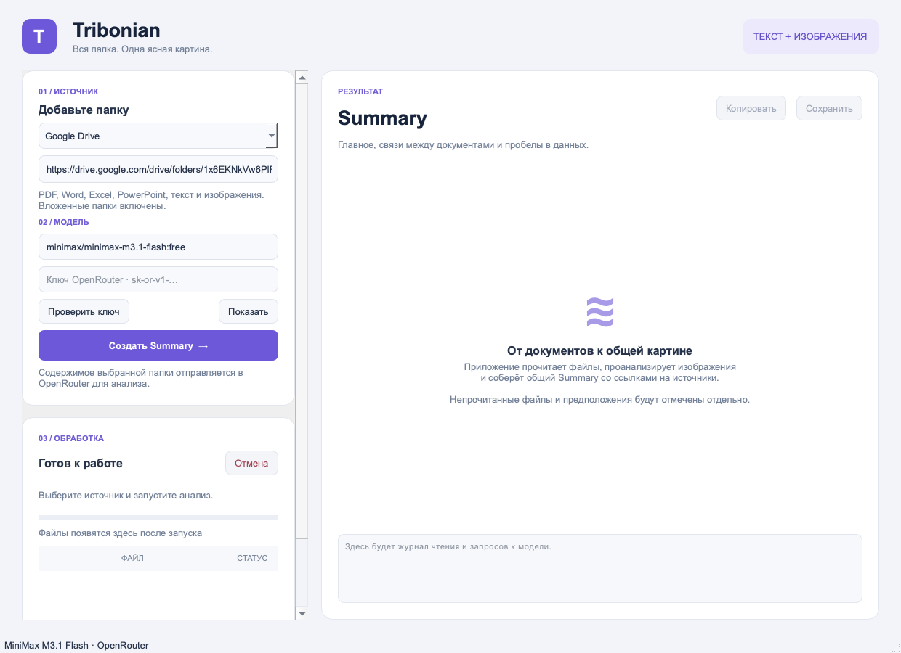

# Tribonian

Настольное Python-приложение, которое делает общий **Summary содержимого папки**: читает документы и изображения, связывает факты между источниками и показывает пробелы в данных.



- Локальная папка или публичная ссылка Google Drive, включая вложенные папки.
- Прогресс поиска, скачивания, чтения, анализа LLM и составления Summary.
- Текст и изображения через OpenRouter; по умолчанию `minimax/minimax-m3.1-flash:free`.
- Статус каждого файла: **Прочитан / Частично / Не прочитан**, причина ошибки и количество обработанных фрагментов.
- Отдельный раздел с осторожными предположениями о непрочитанных файлах по имени и общему контексту. Такие предположения прямо помечены как непроверенные.
- Копирование результата, экспорт в Markdown и JSON, отмена обработки, проверка API-ключа.

## Быстрый запуск

Требуется Python 3.11 или новее; проверяемая в CI версия — Python 3.12. Для анализа нужен интернет и ключ OpenRouter.

```bash
git clone https://github.com/KirP32/Tribonian.git
cd Tribonian
```

**Windows / PowerShell:**

```powershell
py -3.12 -m venv .venv
.\.venv\Scripts\python.exe -m pip install .
.\.venv\Scripts\python.exe -m tribonian
```

**macOS / Linux:**

```bash
python3 -m venv .venv
.venv/bin/python -m pip install .
.venv/bin/python -m tribonian
```

На Linux необходим графический сеанс; при отсутствии системных библиотек Qt установите `libegl1`, `libopengl0`, `libxcb-cursor0`.

Для воспроизводимой установки с [uv](https://docs.astral.sh/uv/):

```bash
uv sync --locked
uv run python -m tribonian
```

В приложении вставьте ключ OpenRouter, нажмите **«Проверить ключ»**, выберите источник и нажмите **«Создать Summary»**. Ссылка из задания уже подставлена.

Ключ можно хранить в `.env` в корне проекта:

```dotenv
OPENROUTER_API_KEY=ваш_ключ
OPENROUTER_MODEL=minimax/minimax-m3.1-flash:free
```

Скопируйте `.env.example` в `.env` и заполните значение. Файл `.env` исключён из Git; ключ из поля приложения действует только до закрытия программы. В собранном приложении `.env` читается рядом с исполняемым файлом. Переменные окружения имеют приоритет.

## Windows без установки Python

Откройте [Actions](https://github.com/KirP32/Tribonian/actions/workflows/verify.yml), выберите успешный запуск и скачайте артефакт **Tribonian-Windows**. Распакуйте архив целиком и запустите `Tribonian.exe`. Папка `_internal` должна оставаться рядом с `.exe`. Для скачивания артефакта GitHub может потребовать вход в аккаунт.

Сборка выполняется автоматически при обновлении `main`. Ключ в неё не включается: вставьте его в интерфейсе или положите `.env` рядом с `.exe`.

Самостоятельная сборка на Windows:

```powershell
.\.venv\Scripts\python.exe -m pip install ".[dev]"
.\.venv\Scripts\pyinstaller.exe --noconfirm --clean --windowed --onedir --name Tribonian --collect-all pypdfium2 --collect-all pypdfium2_raw run_app.py
```

Результат находится в `dist/Tribonian/`. Сборку `.exe` нужно выполнять на Windows; PyInstaller не является кросс-компилятором.

## Поддерживаемые данные

| Формат | Что анализируется |
|---|---|
| PDF | Текст всех страниц; сканы, изображения и страницы с насыщенной векторной графикой дополнительно отправляются в vision-модель |
| PNG, JPEG, WebP, GIF, BMP, TIFF | Изображения; все кадры многостраничных файлов |
| DOCX | Абзацы, таблицы, колонтитулы и встроенные растровые изображения |
| XLSX, XLSM | Все листы, адреса ячеек, значения, формулы и встроенные растровые изображения |
| PPTX | Текст, таблицы, данные диаграмм, заметки и встроенные растровые изображения |
| TXT, MD, CSV, TSV, JSON, XML, HTML, YAML, LOG, RST | Текст с определением кодировки; HTML очищается от скриптов и стилей |

Рекурсивное скачивание Google Drive выполняет `gdown`. Google-документы обрабатываются в формате, в который их экспортирует `gdown`; экспорту требуются права на скачивание. Закрытые папки, запрет скачивания и квоты Drive приводят к понятной ошибке. Сбой скачивания отдельного файла не скрывает остальные файлы. Если Drive не позволяет получить сам список папки, анализ не начинается: утверждать полноту такого списка нельзя.

Старые `.doc`, `.xls`, `.ppt`, архивы, видео, аудио и прочие неподдерживаемые форматы попадают в отчёт как **непрочитанные**. Их можно предварительно конвертировать. Размер одного файла ограничен 100 МБ. Символические ссылки не обходятся; служебные `.git`, `.venv`, `node_modules`, `__pycache__`, `.DS_Store`, `.env` и `.env.*` исключаются из локального обхода.

## Как это устроено

1. `sources.py` собирает полный доступный список локальных файлов или скачивает публичную папку Drive во временную директорию. Содержимое разных файлов с одинаковыми именами не перезаписывается.
2. `extract.py` извлекает данные. Длинный текст делится на фрагменты до 80 000 символов без обрезания хвоста. Страницы PDF сохраняют номера; картинки подготавливаются для vision.
3. `llm.py` отправляет каждый фрагмент в OpenRouter. Временные сетевые ошибки и HTTP 429/5xx повторяются с задержкой. Обрезанный ответ повторяется с увеличенным лимитом токенов, пустой или окончательно обрезанный ответ не считается успешным.
4. `pipeline.py` собирает выжимки в общий Summary. Для небольшой папки финальный запрос также содержит первичные тексты и изображения для сверки; для большого объёма есть промежуточное иерархическое сжатие. В финальный запрос обязательно входят реестр всех обнаруженных файлов, статусы и ошибки.
5. `gui.py` выполняет обработку в рабочем потоке, поэтому окно остаётся отзывчивым. Отмена прерывает работу между операциями; текущий запрос может завершаться до сетевого тайм-аута.

Файл получает статус **Прочитан** только после успешного извлечения и анализа всех его частей. Если часть данных удалось обработать до ошибки, статус — **Частично**. Если полезного результата нет, статус — **Не прочитан**. При сбое финального Summary сохраняются промежуточные выжимки с явной пометкой.

Статус отражает техническое покрытие, а не гарантию безошибочной расшифровки: качество OCR и выводов зависит от модели и качества изображений. Изображения уменьшаются до 1800 пикселей по длинной стороне; очень мелкий текст может потеряться. Формулы Excel передаются как формулы, не вычисляются. Обнаруженные OLE-объекты, SmartArt, неподдерживаемые медиавложения, сноски Word и невизуализированные диаграммы Word/Excel дают статус «Частично» после извлечения доступного текста; для них рекомендуется экспорт в PDF. Детектор не заменяет полноценный рендеринг сложной разметки Office. Программа составляет summary предоставленной версии правового документа и не проверяет актуальность законодательства.

Имена и содержимое документов передаются модели как данные. Инструкция в документе не получает доступа к инструментам, компьютеру или секретам приложения. В запрос уходит только выбранное содержимое; ключ используется в заголовке авторизации OpenRouter. Временные скачанные файлы удаляются после завершения.

## CLI

Ключ берётся из окружения или `.env`.

```bash
python -m tribonian.cli --folder ./sample-data --output ./reports/summary.md
python -m tribonian.cli --drive "https://drive.google.com/drive/folders/1x6EKNkVw6PlFVTr6cGrsVscmRuwqGrXd" --output ./reports/summary.md
```

Рядом с Markdown сохраняется JSON с реестром файлов и выжимками по фрагментам. Код выхода `0` означает полное техническое покрытие, `2` — отчёт с пробелами, `1` — ошибка запуска, `130` — прерывание.

## QA

```bash
uv sync --locked --extra dev
uv run pytest -q
uv run ruff check .
uv run ruff format --check .
```

Автотесты работают без ключа и без сетевых запросов. Они проверяют извлечение форматов, рекурсивный обход, отсутствие потери хвоста текста, повреждённые и неподдерживаемые файлы, частичный результат, HTTP-ошибки, лимиты, отмену, экспорт и поведение интерфейса. CI запускает тесты на Linux и Windows, затем собирает Windows-приложение и проверяет запуск готового `.exe`.

Для живой проверки используйте кнопку «Проверить ключ» и ссылку из задания. Бесплатный вариант модели указан с суффиксом **`:free`**: приложение не переключается автоматически на платный маршрут. Бесплатные модели имеют ограничения частоты и доступности со стороны провайдера.

API: [OpenRouter Chat Completions](https://openrouter.ai/docs/api/api-reference/chat/create-a-chat-completion), [MiniMax M3.1 Flash free](https://openrouter.ai/minimax/minimax-m3.1-flash:free).
